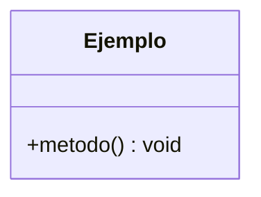

# Análisis · Ejercicio N: <nombre del caso>

- **Autor(es):**
- **Fecha:**

## 1. Hallazgos

Registre un hallazgo por fila. En **Tipo** use una de estas categorías:

- **Violación:** el diseño incumple un principio y eso tiene un costo real.
- **Abstracción defectuosa:** existe una abstracción, pero está mal ubicada, filtra detalles o promete algo que no cumple.
- **Abstracción innecesaria:** existe una abstracción que ningún cambio previsible justifica.

| # | Tipo | Principio | Ubicación (archivo y método) | Evidencia | Consecuencia (ligada a un cambio previsto) |
|---|---|---|---|---|---|
| 1 | | | | | |
| 2 | | | | | |
| 3 | | | | | |

## 2. Respuestas a las actividades

### Actividad 1

### Actividad 2

<!-- Continúe con todas las actividades del enunciado. -->

## 3. Inventario de abstracciones

Liste las interfaces, clases abstractas y patrones del diseño **original** y evalúe cada uno.

| Elemento | ¿Qué cambio concreto protege? | Implementaciones actuales o previstas | Veredicto (mantener / eliminar / corregir) |
|---|---|---|---|
| | | | |

## 4. Rediseño propuesto

### Justificación

Para cada clase o interfaz **nueva**, indique qué cambio previsto la justifica. Para cada elemento **eliminado**, explique por qué no se necesita.

| Elemento | Decisión | Justificación |
|---|---|---|
| | | |

## 5. Lo que decidí no cambiar

<!-- Describa al menos una parte del diseño que dejó igual a propósito, y por qué. -->
