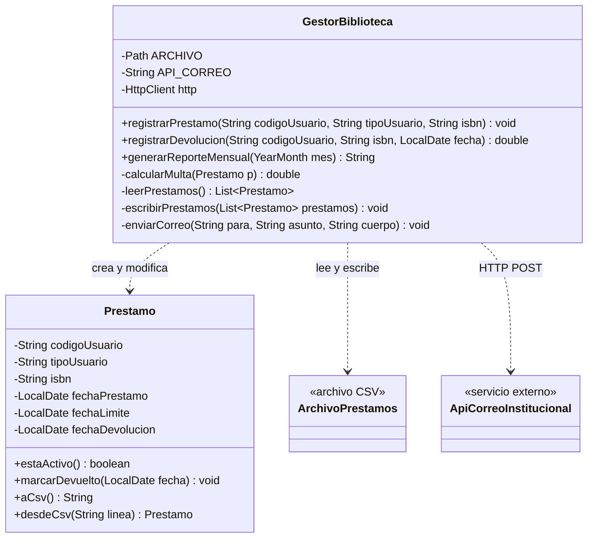

# Ejercicio 1 · Préstamos de la Biblioteca Central

| Nivel | Tiempo estimado | Paquete |
|---|---|---|
| Básico | 60 minutos | `co.edu.ingsoft.solid.ej01biblioteca` |

## Contexto

La Biblioteca Central de la universidad tiene un pequeño sistema para registrar préstamos de libros. Lo escribió un practicante hace dos años y desde entonces ha funcionado sin mayores problemas. Hoy cuatro dependencias distintas intervienen sobre él:

| Dependencia | Qué decide |
|---|---|
| **Biblioteca (circulación)** | Cuántos libros puede tener cada tipo de usuario y por cuántos días |
| **Vicerrectoría Financiera** | El valor de las multas por devolución tardía y quién está exento |
| **Bienestar Universitario** | El contenido del reporte mensual que se presenta al Consejo Académico |
| **Oficina TIC** | Dónde se almacenan los datos y cómo se notifica a los usuarios |

### Reglas vigentes

- Estudiantes: máximo 3 préstamos simultáneos, 8 días por préstamo.
- Docentes: máximo 10 préstamos simultáneos, 30 días por préstamo, exentos de multa.
- Multa: $1.500 por cada día de retraso.
- Los préstamos se guardan en `datos/prestamos.csv` y las notificaciones se envían con la API de correo institucional.

### Cambios previstos para los próximos dos semestres

1. **Financiera:** a partir de 2027-I la multa pasará a $2.000 diarios con un tope de $30.000 por préstamo. Los docentes empezarán a pagar multa después de 15 días de retraso.
2. **Bienestar:** el reporte mensual debe contar *todos* los préstamos devueltos con retraso, incluidos los de docentes, aunque no generen multa.
3. **Biblioteca:** se crea el tipo de usuario `EGRESADO` (2 préstamos, 5 días, paga multa como estudiante).
4. **Oficina TIC:** en 2027-II los datos se migrarán a la base de datos PostgreSQL institucional, y el correo será reemplazado por notificaciones en la aplicación móvil de la universidad.
5. **Aseguramiento de calidad:** todas las reglas de negocio deberán tener pruebas automatizadas que se ejecuten en el *pipeline* de integración continua, que no tiene acceso a red ni a disco persistente.

## Código

| Archivo | Descripción |
|---|---|
| [`Prestamo.java`](../../src/main/java/co/edu/ingsoft/solid/ej01biblioteca/Prestamo.java) | Datos de un préstamo |
| [`GestorBiblioteca.java`](../../src/main/java/co/edu/ingsoft/solid/ej01biblioteca/GestorBiblioteca.java) | Operaciones del sistema |

## Diagrama de clases (diseño actual)

## Actividades

1. **Hallazgos.** Identifique cada violación de los principios SOLID. Para cada una indique el principio, la ubicación exacta (archivo y método), la evidencia en el código y la **consecuencia concreta** que tendría al implementar alguno de los cambios previstos.
2. **Análisis de impacto.** Suponga que, para atender el cambio 1, un desarrollador modifica únicamente `calcularMulta`. ¿Qué ocurre con el reporte de Bienestar? ¿Cómo interactúa esto con el cambio 2?
3. **Puntos de cambio.** Para el cambio 3, liste todas las líneas que habría que modificar. ¿Qué riesgo introduce que el tipo de usuario sea un `String`?
4. **Capacidad de prueba.** Intente escribir (o describa) una prueba unitaria para la regla de multas. ¿Qué lo impide? Relacione su respuesta con el cambio 5.
5. **Abstracciones innecesarias.** ¿Hay en este código alguna abstracción que sobre? ¿Hay alguna que, a la luz de los cambios previstos, *no* convenga introducir todavía?
6. **Rediseño.** Proponga un nuevo diseño con su diagrama de clases en Mermaid. Justifique cada clase o interfaz nueva con un cambio previsto concreto.

Registre sus respuestas usando la [plantilla de análisis](../../docs/plantilla-analisis.md).
