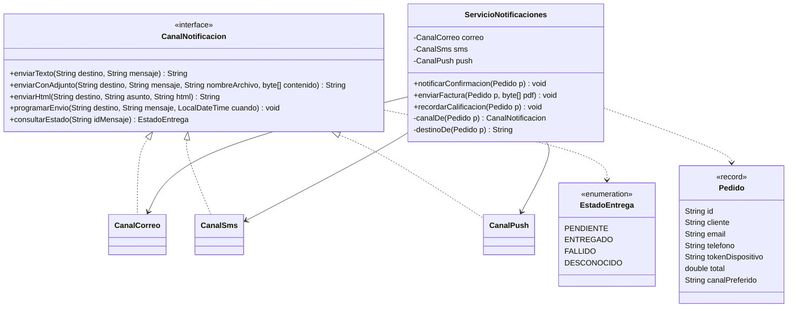

# Ejercicio 2 · Notificaciones de DomiExpress

| Nivel | Tiempo estimado | Paquete |
|---|---|---|
| Intermedio | 75 minutos | `co.edu.ingsoft.solid.ej02notificaciones` |

## Contexto

DomiExpress es una *startup* de domicilios que opera en el Valle de Aburrá. Cada cliente elige en la aplicación su canal preferido para recibir notificaciones: correo electrónico, SMS o notificación *push*. El sistema envía tres tipos de mensajes por pedido:

| Mensaje | Momento | Contenido |
|---|---|---|
| Confirmación | Al aceptar el pedido | Saludo y valor total |
| Factura | Al entregar el pedido | Factura en PDF |
| Recordatorio de calificación | Dos horas después de la entrega | Invitación a calificar el servicio |

El equipo definió una interfaz común, `CanalNotificacion`, que deben implementar todos los canales. Los proveedores tienen capacidades distintas: el proveedor de SMS no admite adjuntos ni envíos programados, y el servicio de *push* no admite HTML.

### Cambios previstos para el próximo trimestre

1. **Producto:** se agregará **WhatsApp** como canal. El proveedor admite texto y documentos PDF adjuntos, pero no HTML ni envíos programados.
2. **Contabilidad:** la factura **debe llegar siempre** al cliente por algún medio. Hoy hay quejas de clientes que nunca la recibieron.
3. **Mercadeo:** quiere medir la tasa de entrega real de cada canal con `consultarEstado` para decidir en cuál invertir.
4. **Producto:** los clientes podrán elegir **dos canales** (por ejemplo, *push* y correo) en lugar de uno.

## Código

| Archivo | Descripción |
|---|---|
| [`CanalNotificacion.java`](../../src/main/java/co/edu/ingsoft/solid/ej02notificaciones/CanalNotificacion.java) | Contrato común de los canales |
| [`CanalCorreo.java`](../../src/main/java/co/edu/ingsoft/solid/ej02notificaciones/CanalCorreo.java) | Canal de correo electrónico |
| [`CanalSms.java`](../../src/main/java/co/edu/ingsoft/solid/ej02notificaciones/CanalSms.java) | Canal de SMS |
| [`CanalPush.java`](../../src/main/java/co/edu/ingsoft/solid/ej02notificaciones/CanalPush.java) | Canal de notificaciones *push* |
| [`ServicioNotificaciones.java`](../../src/main/java/co/edu/ingsoft/solid/ej02notificaciones/ServicioNotificaciones.java) | Orquesta los envíos de cada pedido |
| [`Pedido.java`](../../src/main/java/co/edu/ingsoft/solid/ej02notificaciones/Pedido.java), [`EstadoEntrega.java`](../../src/main/java/co/edu/ingsoft/solid/ej02notificaciones/EstadoEntrega.java) | Tipos de datos |
| [`DemoNotificaciones.java`](../../src/main/java/co/edu/ingsoft/solid/ej02notificaciones/DemoNotificaciones.java) | Programa de demostración |

## Diagrama de clases (diseño actual)



## Cómo ejecutarlo

```bash
mvn -q compile
java -cp target/classes co.edu.ingsoft.solid.ej02notificaciones.DemoNotificaciones
```

## Actividades

1. **Observación.** Ejecute la demostración. Para cada uno de los tres clientes, indique qué mensajes llegaron, cuáles fallaron y cuáles llegaron **incompletos sin que nadie se enterara**.
2. **Hallazgos.** Identifique cada violación de los principios SOLID con su principio, ubicación, evidencia y consecuencia. Revise con atención el contrato documentado en `CanalNotificacion` y compárelo con lo que hace realmente cada implementación, incluido `consultarEstado`.
3. **Cambio 1.** Describa paso a paso qué habría que modificar para agregar WhatsApp con el diseño actual. ¿Cuántas clases existentes se tocan? ¿Qué métodos tendría que implementar WhatsApp aunque no pueda cumplirlos?
4. **Cambio 3.** ¿Son confiables los datos que obtendría Mercadeo? Justifique con el código.
5. **Discusión.** En `recordarCalificacion` se usa `instanceof CanalSms`. ¿Es un síntoma del problema o una solución razonable? ¿Qué pasaría con el cambio 1?
6. **Abstracciones innecesarias.** ¿Hay alguna abstracción que sobre? ¿La interfaz `CanalNotificacion` debería desaparecer, dividirse o mantenerse?
7. **Rediseño.** Proponga un diseño que soporte los cuatro cambios previstos, con su diagrama de clases en Mermaid.

Registre sus respuestas usando la [plantilla de análisis](../../docs/plantilla-analisis.md).
