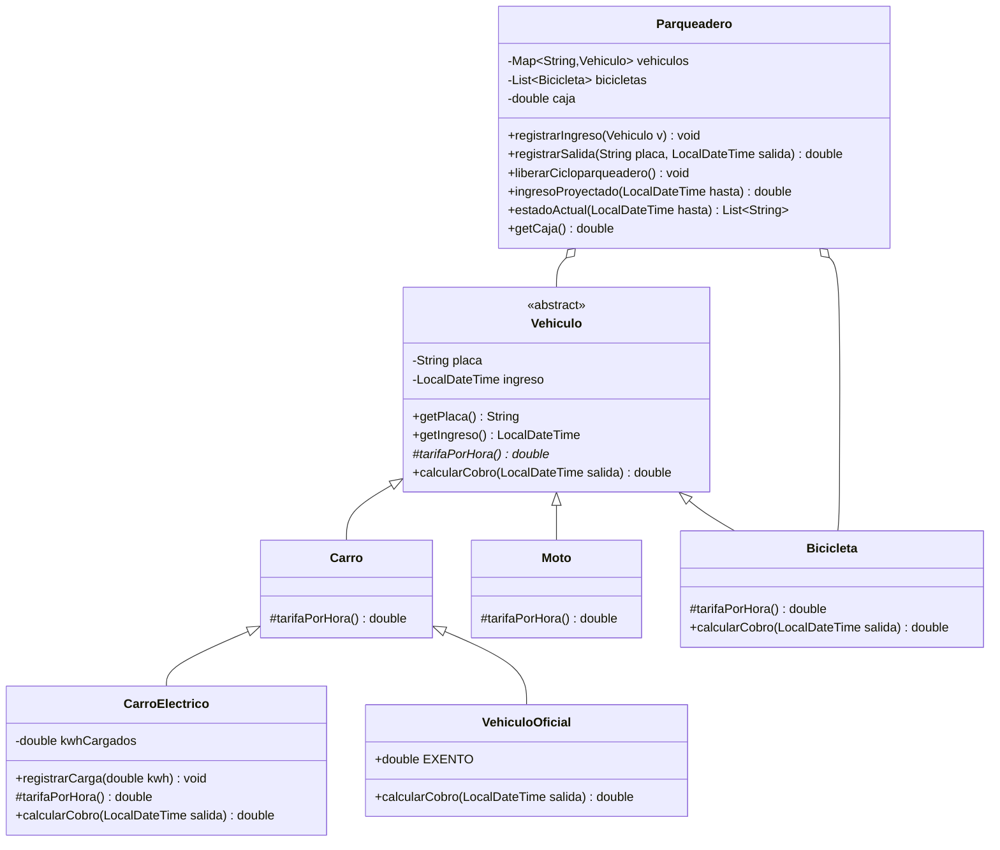

# Ejercicio 3 · Parqueadero ParkCentro

| Nivel | Tiempo estimado | Paquete |
|---|---|---|
| Intermedio | 75 minutos | `co.edu.ingsoft.solid.ej03parqueadero` |

## Contexto

ParkCentro administra un parqueadero frente al campus. El software registra el ingreso y la salida de vehículos, calcula el cobro y lleva la caja del día. El modelo se diseñó con una jerarquía de herencia a partir de la clase abstracta `Vehiculo`, cuyo contrato está documentado en el método `calcularCobro`.

### Reglas vigentes

| Tipo | Tarifa | Observaciones |
|---|---|---|
| Carro | $4.500 por hora o fracción | Mínimo una hora |
| Moto | $2.200 por hora o fracción | Mínimo una hora |
| Carro eléctrico | $3.000 por hora o fracción | Más $900 por kWh cargado en la estación |
| Vehículo oficial | Exento | Convenio con la Alcaldía Local |
| Bicicleta | Gratuita | Cicloparqueadero; no tienen placa |

### Cambios previstos

1. **Gerencia:** se habilitarán **patinetas eléctricas** en el cicloparqueadero: no pagan por el espacio, pero sí por la carga ($900 por kWh).
2. **Gerencia:** se ofrecerán **mensualidades**: los abonados no pagan por hora, pero se registra su permanencia.
3. **Operaciones:** la pantalla de la entrada mostrará en tiempo real el estado del parqueadero usando `estadoActual`.
4. **Contabilidad:** la caja del día y el ingreso proyectado se usarán para la conciliación con el banco y deben cuadrar al peso.

## Código

| Archivo | Descripción |
|---|---|
| [`Vehiculo.java`](../../src/main/java/co/edu/ingsoft/solid/ej03parqueadero/Vehiculo.java) | Clase base y contrato de `calcularCobro` |
| [`Carro.java`](../../src/main/java/co/edu/ingsoft/solid/ej03parqueadero/Carro.java), [`Moto.java`](../../src/main/java/co/edu/ingsoft/solid/ej03parqueadero/Moto.java) | Vehículos con tarifa por hora |
| [`CarroElectrico.java`](../../src/main/java/co/edu/ingsoft/solid/ej03parqueadero/CarroElectrico.java) | Carro con cargo por energía |
| [`VehiculoOficial.java`](../../src/main/java/co/edu/ingsoft/solid/ej03parqueadero/VehiculoOficial.java) | Vehículo exento |
| [`Bicicleta.java`](../../src/main/java/co/edu/ingsoft/solid/ej03parqueadero/Bicicleta.java) | Bicicleta sin placa |
| [`Parqueadero.java`](../../src/main/java/co/edu/ingsoft/solid/ej03parqueadero/Parqueadero.java) | Ingresos, salidas, caja y reportes |
| [`DemoParqueadero.java`](../../src/main/java/co/edu/ingsoft/solid/ej03parqueadero/DemoParqueadero.java) | Programa de demostración |

## Diagrama de clases (diseño actual)



## Cómo ejecutarlo

```bash
mvn -q compile
java -cp target/classes co.edu.ingsoft.solid.ej03parqueadero.DemoParqueadero
```

## Actividades

1. **Observación.** Ejecute la demostración. Calcule a mano el valor que *debería* tener la caja y el ingreso proyectado, y compárelo con lo que imprime el programa. ¿Qué falló y por qué?
2. **Sustituibilidad.** Para **cada** subclase de `Vehiculo` (incluida `CarroElectrico`), decida si es sustituible por su clase base según el contrato documentado. Justifique en términos de precondiciones, postcondiciones e invariantes. No asuma que todas tienen el mismo veredicto.
3. **Hallazgos.** Identifique las violaciones de SOLID con su principio, ubicación, evidencia y consecuencia. Preste atención a cómo `Parqueadero` trata los casos especiales.
4. **Cambios 1 y 2.** ¿Dónde encajarían la patineta eléctrica y el abonado mensual en la jerarquía actual? ¿Qué problemas aparecen al intentarlo?
5. **Abstracciones innecesarias.** ¿Sobra alguna clase de la jerarquía? ¿Es la herencia el mecanismo adecuado para modelar la *forma de cobro*?
6. **Rediseño.** Proponga un diseño que separe *qué ocupa un espacio* de *cómo se cobra*, con su diagrama de clases en Mermaid, y verifique que soporta los cuatro cambios previstos.

Registre sus respuestas usando la [plantilla de análisis](../../docs/plantilla-analisis.md).
