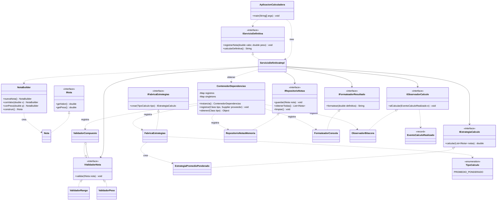

# Ejercicio 4 · Calculadora de nota definitiva

| Nivel | Tiempo estimado | Paquete |
|---|---|---|
| Intermedio | 60 minutos | `co.edu.ingsoft.solid.ej04notas` |

## Contexto

El profesor de Cálculo I le pidió a su monitor un programa de consola para calcular la nota definitiva de sus estudiantes al cierre del semestre. Al entregarlo, el monitor comentó con orgullo:

> «Lo hice siguiendo SOLID al pie de la letra: todo depende de interfaces, usé Estrategia, Fábrica, Builder, Observador, un repositorio y hasta un contenedor de inyección de dependencias. Así queda listo para cualquier cambio futuro.»

### Requisitos

- Tres parciales con pesos de 30 %, 30 % y 40 %.
- Las notas están en la escala de 0,0 a 5,0.
- Según el reglamento estudiantil, la definitiva se expresa con **una cifra decimal** y el estudiante aprueba si esa definitiva es **mayor o igual a 3,0**.

### Información adicional

- El profesor usa el programa **una vez por semestre**, desde su computador, para unos 40 estudiantes.
- No se guarda ninguna información: las notas oficiales se registran en el sistema académico de la universidad.
- El esquema de evaluación del curso lo fija el reglamento y **no ha cambiado desde 2015**. No hay planes de usar el programa en otros cursos.
- **Cambios previstos:** ninguno conocido.

## Código

El programa tiene 23 archivos organizados en 8 paquetes más la raíz:

| Paquete | Archivos |
|---|---|
| `modelo` | [`INota`](../../src/main/java/co/edu/ingsoft/solid/ej04notas/modelo/INota.java), [`Nota`](../../src/main/java/co/edu/ingsoft/solid/ej04notas/modelo/Nota.java), [`NotaBuilder`](../../src/main/java/co/edu/ingsoft/solid/ej04notas/modelo/NotaBuilder.java) |
| `validacion` | [`IValidadorNota`](../../src/main/java/co/edu/ingsoft/solid/ej04notas/validacion/IValidadorNota.java), [`ValidadorRango`](../../src/main/java/co/edu/ingsoft/solid/ej04notas/validacion/ValidadorRango.java), [`ValidadorPeso`](../../src/main/java/co/edu/ingsoft/solid/ej04notas/validacion/ValidadorPeso.java), [`ValidadorCompuesto`](../../src/main/java/co/edu/ingsoft/solid/ej04notas/validacion/ValidadorCompuesto.java) |
| `calculo` | [`IEstrategiaCalculo`](../../src/main/java/co/edu/ingsoft/solid/ej04notas/calculo/IEstrategiaCalculo.java), [`EstrategiaPromedioPonderado`](../../src/main/java/co/edu/ingsoft/solid/ej04notas/calculo/EstrategiaPromedioPonderado.java), [`IFabricaEstrategias`](../../src/main/java/co/edu/ingsoft/solid/ej04notas/calculo/IFabricaEstrategias.java), [`FabricaEstrategias`](../../src/main/java/co/edu/ingsoft/solid/ej04notas/calculo/FabricaEstrategias.java), [`TipoCalculo`](../../src/main/java/co/edu/ingsoft/solid/ej04notas/calculo/TipoCalculo.java) |
| `persistencia` | [`IRepositorioNotas`](../../src/main/java/co/edu/ingsoft/solid/ej04notas/persistencia/IRepositorioNotas.java), [`RepositorioNotasMemoria`](../../src/main/java/co/edu/ingsoft/solid/ej04notas/persistencia/RepositorioNotasMemoria.java) |
| `presentacion` | [`IFormateadorResultado`](../../src/main/java/co/edu/ingsoft/solid/ej04notas/presentacion/IFormateadorResultado.java), [`FormateadorConsola`](../../src/main/java/co/edu/ingsoft/solid/ej04notas/presentacion/FormateadorConsola.java) |
| `eventos` | [`EventoCalculoRealizado`](../../src/main/java/co/edu/ingsoft/solid/ej04notas/eventos/EventoCalculoRealizado.java), [`IObservadorCalculo`](../../src/main/java/co/edu/ingsoft/solid/ej04notas/eventos/IObservadorCalculo.java), [`ObservadorBitacora`](../../src/main/java/co/edu/ingsoft/solid/ej04notas/eventos/ObservadorBitacora.java) |
| `infraestructura` | [`ContenedorDependencias`](../../src/main/java/co/edu/ingsoft/solid/ej04notas/infraestructura/ContenedorDependencias.java) |
| `servicio` | [`IServicioDefinitiva`](../../src/main/java/co/edu/ingsoft/solid/ej04notas/servicio/IServicioDefinitiva.java), [`ServicioDefinitivaImpl`](../../src/main/java/co/edu/ingsoft/solid/ej04notas/servicio/ServicioDefinitivaImpl.java) |
| raíz | [`AplicacionCalculadora`](../../src/main/java/co/edu/ingsoft/solid/ej04notas/AplicacionCalculadora.java) |

## Diagrama de clases (diseño actual)



## Cómo ejecutarlo

```bash
mvn -q compile
# Sin argumentos usa las notas 3.2, 2.8 y 3.5
java -cp target/classes co.edu.ingsoft.solid.ej04notas.AplicacionCalculadora
java -cp target/classes co.edu.ingsoft.solid.ej04notas.AplicacionCalculadora 4.0 3.5 4.2
```

## Actividades

1. **Pruebas manuales.** Ejecute el programa con los casos de la tabla. Calcule a mano el resultado esperado según el reglamento y compárelo con la salida del programa.

   | Caso | Parcial 1 | Parcial 2 | Parcial 3 |
   |---|---|---|---|
   | A | 3.2 | 2.8 | 3.5 |
   | B | 3.0 | 2.9 | 3.0 |
   | C | 5.0 | 5.0 | 5.0 |
   | D | 2.0 | 6.0 | 3.0 |

2. **Inventario.** Para cada interfaz, patrón o paquete del diseño, responda: ¿qué cambio concreto y previsible protege? ¿Cuántas implementaciones tiene o tendrá? Clasifíquelo como *justificado* o *innecesario*.
3. **Costo.** Cuente archivos, líneas de código y saltos de navegación necesarios para seguir el flujo desde `main` hasta la fórmula del promedio. Compárelo con una solución directa.
4. **¿SOLID de verdad?** El monitor afirma que el servicio «depende de abstracciones». Revise cómo obtiene `ServicioDefinitivaImpl` sus colaboradores. ¿Se cumple realmente la inversión de dependencias? ¿Qué patrón es `ContenedorDependencias` y qué problemas trae?
5. **Hallazgos.** Además de la complejidad, ¿encontró algún defecto funcional? ¿La estructura ayudó o dificultó encontrarlo?
6. **Simplificación.** Escriba la versión más simple que cumpla todos los requisitos y diga cuántos archivos tiene.
7. **Escenario futuro.** Describa un cambio realista que haría que **una** de las abstracciones eliminadas valiera la pena. ¿Cuál sería y cuándo la introduciría?

Registre sus respuestas usando la [plantilla de análisis](../../docs/plantilla-analisis.md).
