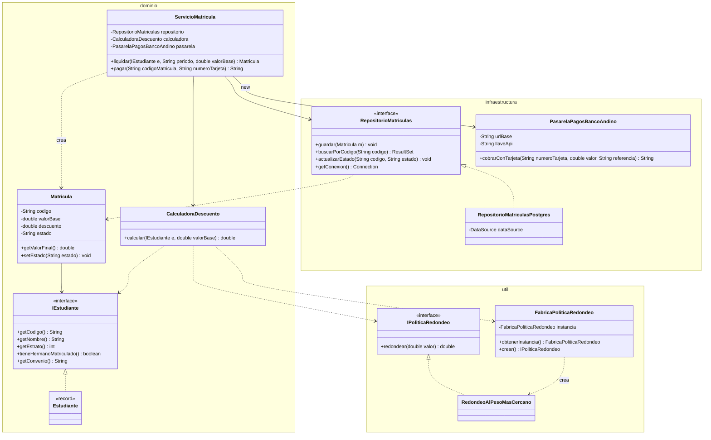

# Ejercicio 5 · Liquidación y pago de matrícula

| Nivel | Tiempo estimado | Paquete |
|---|---|---|
| Avanzado | 90 minutos | `co.edu.ingsoft.solid.ej05matricula` |

## Contexto

La universidad tiene un módulo que liquida el valor de la matrícula de pregrado aplicando descuentos y permite pagarla con tarjeta de crédito. El equipo que lo construyó afirma haber aplicado buenas prácticas: hay interfaces, una fábrica, un repositorio y separación en paquetes `dominio`, `infraestructura` y `util`.

### Actores

| Actor | Qué decide |
|---|---|
| **Consejo Superior** | Los descuentos, mediante un acuerdo que se expide **cada semestre** |
| **Tesorería** | Los medios y proveedores de pago, y la política de redondeo |
| **Oficina TIC** | La base de datos y la infraestructura |
| **Aseguramiento de calidad** | Las pruebas exigidas antes de cada despliegue |

### Reglas vigentes (Acuerdo 2026-II)

- Estratos 1 y 2: 50 % de descuento. Estrato 3: 25 %.
- Hermano matriculado: 10 % adicional.
- Convenio con la Alcaldía: 20 % adicional. Convenio con empresa aliada: 15 % adicional.
- El descuento total no puede superar el 70 %.
- Los valores se redondean al peso más cercano.

### Cambios previstos para 2027-I

1. **Consejo Superior:** el nuevo acuerdo agrega descuentos por **deportista destacado** (15 %) y **egresado de la universidad** (10 %), y elimina el convenio con empresa aliada.
2. **Tesorería:** se incorporan **PSE** y un segundo adquirente de tarjetas (Banco Pacífico). El proveedor de tarjetas se elegirá por licitación cada dos años.
3. **Aseguramiento de calidad:** la liquidación y el flujo de pago deben tener pruebas automatizadas que **no requieran base de datos ni conexión a la pasarela**.
4. **Oficina TIC:** se reportaron agotamientos del *pool* de conexiones en las semanas de pago de matrícula.

### Información adicional

- La política de redondeo al peso está definida por resolución de Tesorería y no ha cambiado en veinte años. No hay planes de modificarla.
- El módulo solo atiende estudiantes de pregrado presencial; los posgrados y la educación continua usan otros sistemas.

## Código

| Paquete | Archivos |
|---|---|
| `dominio` | [`IEstudiante`](../../src/main/java/co/edu/ingsoft/solid/ej05matricula/dominio/IEstudiante.java), [`Estudiante`](../../src/main/java/co/edu/ingsoft/solid/ej05matricula/dominio/Estudiante.java), [`Matricula`](../../src/main/java/co/edu/ingsoft/solid/ej05matricula/dominio/Matricula.java), [`CalculadoraDescuento`](../../src/main/java/co/edu/ingsoft/solid/ej05matricula/dominio/CalculadoraDescuento.java), [`ServicioMatricula`](../../src/main/java/co/edu/ingsoft/solid/ej05matricula/dominio/ServicioMatricula.java) |
| `infraestructura` | [`RepositorioMatriculas`](../../src/main/java/co/edu/ingsoft/solid/ej05matricula/infraestructura/RepositorioMatriculas.java), [`RepositorioMatriculasPostgres`](../../src/main/java/co/edu/ingsoft/solid/ej05matricula/infraestructura/RepositorioMatriculasPostgres.java), [`PasarelaPagosBancoAndino`](../../src/main/java/co/edu/ingsoft/solid/ej05matricula/infraestructura/PasarelaPagosBancoAndino.java) |
| `util` | [`IPoliticaRedondeo`](../../src/main/java/co/edu/ingsoft/solid/ej05matricula/util/IPoliticaRedondeo.java), [`RedondeoAlPesoMasCercano`](../../src/main/java/co/edu/ingsoft/solid/ej05matricula/util/RedondeoAlPesoMasCercano.java), [`FabricaPoliticaRedondeo`](../../src/main/java/co/edu/ingsoft/solid/ej05matricula/util/FabricaPoliticaRedondeo.java) |
| raíz | [`DemoMatricula`](../../src/main/java/co/edu/ingsoft/solid/ej05matricula/DemoMatricula.java) |

## Diagrama de clases (diseño actual)



## Cómo ejecutarlo

```bash
mvn -q compile
java -cp target/classes co.edu.ingsoft.solid.ej05matricula.DemoMatricula
```

## Actividades

Este ejercicio mezcla tres tipos de problemas. Clasifique cada hallazgo en una de estas categorías:

- **A. Abstracción ausente:** falta una abstracción que los cambios previstos hacen necesaria.
- **B. Abstracción defectuosa:** existe una abstracción, pero está mal ubicada o filtra detalles.
- **C. Abstracción innecesaria:** existe una abstracción que ningún cambio previsible justifica.

1. **Hallazgos.** Para cada problema indique la categoría (A, B o C), el principio involucrado, la ubicación, la evidencia y la consecuencia frente a los cambios previstos.
2. **Dependencias entre paquetes.** Dibuje el grafo de dependencias entre `dominio`, `infraestructura` y `util`. ¿Hacia dónde apuntan las flechas? ¿Hay ciclos? ¿Qué dice esto sobre la inversión de dependencias?
3. **El repositorio.** `RepositorioMatriculas` es una interfaz, así que el dominio «depende de una abstracción». ¿Es suficiente? Analice los tipos que aparecen en sus firmas y dónde está ubicada.
4. **Cambio 3.** Intente escribir (o describa) una prueba de `ServicioMatricula.pagar()` sin base de datos ni pasarela. ¿Qué obstáculos encuentra?
5. **Cambio 4.** Siga el ciclo de vida de la conexión en `buscarPorCodigo` y en `pagar`. ¿Quién la cierra? Relacione su respuesta con el diseño de la interfaz.
6. **Contraste.** El equipo creó una interfaz y una fábrica para el redondeo, pero usa la pasarela de pagos de forma concreta con `new`. Compare ambas decisiones a la luz de la información del contexto.
7. **Rediseño.** Proponga un diseño corregido con su diagrama de clases en Mermaid. Elimine lo innecesario, agregue lo que falta y corrija lo defectuoso, justificando cada decisión con un cambio previsto o con la información del contexto.

Registre sus respuestas usando la [plantilla de análisis](../../docs/plantilla-analisis.md).
